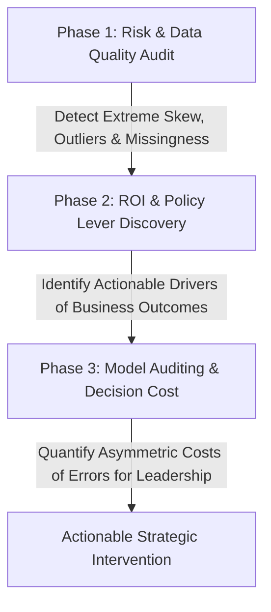
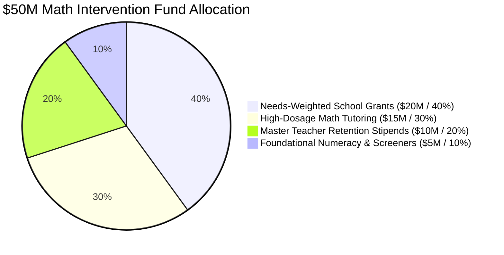

# 🎓 AltSchool Africa: Data Science Portfolio — Third Semester
### 🚀 Baraka 2026 Cohort | Machine Learning Workflows, Visual Diagnostics & Business Value

[](https://www.python.org/)
[](https://jupyter.org/)
[](https://pandas.pydata.org/)
[](https://scikit-learn.org/)
[](https://seaborn.pydata.org/)
[](https://altschoolafrica.com/)
[](https://github.com/iPablo26)

**Portfolio Author:** [Peter "Pablo" Okwukogu](https://github.com/iPablo26)  
**Program:** AltSchool Africa School of Data & Artificial Intelligence  
**Track:** Data Science (Semester 3: Machine Learning Specialization)

---

> [!IMPORTANT]
> ### ⚠️ Educational Use Disclaimer & Caveat
> The dataset utilized throughout this repository ([`us_education_system_dataset.csv`](us_education_system_dataset.csv)) is synthetically modeled and curated **strictly for educational, instructional, and statistical learning purposes**.
> 
> It is **NOT** an authentic reflection, official census data, or governmental report of the real-world United States Educational System, specific school districts, or actual operating institutions. All analyses, findings, and simulated policy recommendations serve purely to demonstrate data science, machine learning visualization, visual diagnostics, and business translation workflows.

---

## 📌 Executive Summary

Welcome to my central portfolio repository for the **Third Semester of the AltSchool Africa Data Science Program (Baraka 2026 Cohort)**. 

The focus of this semester is the complete **Machine Learning Lifecycle**: transitioning from descriptive statistics to predictive modeling, rigorous exploratory data analysis (EDA), diagnostic visualization, dimensionality reduction, feature selection, and translating complex machine learning outputs into high-stakes business and policy decisions.

A central philosophy developed in this portfolio is that **accuracy alone does not impress stakeholders**. A 95% accurate model is useless if decision-makers cannot understand, trust, or act on its predictions. Data visualization serves as the critical translation layer across every phase of the ML pipeline—from data quality auditing to feature engineering, error diagnostics, and capital allocation.

---

## 📂 Repository Structure

```text
Third-Semester-Baraka-2026---Data-Science/
├── .gitignore                                                                       # Clean Git ignore rules (OS, IDE, checkpoints)
├── 2D PCA Projection.png                                                            # Exported 2D PCA projection visual artifact
├── Confusion Matrix.png                                                             # Exported Random Forest Confusion Matrix heatmap
├── corr_matrix.png                                                                  # Exported 9-feature Correlation Matrix heatmap
├── First Live Session Introduction to Visualization for ML.ipynb                    # Live Session 1 (Part 1): Univariate & Multivariate EDA
├── First Live Session Introduction to Visualization for ML - Continuation.ipynb       # Live Session 1 (Part 2): Correlation, Random Forest & PCA
├── README.md                                                                        # Comprehensive portfolio documentation
├── requirements.txt                                                                 # Reproducible Python dependencies
├── Resource Allocation.png                                                          # Exported Resource Allocation & Title I Audit visual artifact
├── Second Live Session - Business Value of Data Visualization for ML.ipynb          # Live Session 2: Business-Valued ML & $50M Policy Intervention
├── us_education_system_data_dictionary.md                                           # 35-variable metadata schema & documentation
└── us_education_system_dataset.csv                                                  # Modeled dataset (5,000 records × 35 features)
```

---

## 🧭 Activities & Curriculum Tracker

| Session / Milestone | Module Focus | Core Deliverables / Artifacts | Status |
| :--- | :--- | :--- | :---: |
| **Live Session 01 (Part 1)** | **Introduction to Visualization for ML** | Univariate, Bivariate & Multivariate EDA on institutional data; skewness & interaction analysis | ✅ Completed |
| **Live Session 01 (Part 2)** | **ML Visualization Continuation: Diagnostics & Dimensionality Reduction** | Correlation Matrix ([`corr_matrix.png`](./corr_matrix.png)), Random Forest Classifier ([`Confusion Matrix.png`](./Confusion%20Matrix.png)), & 2D PCA Embeddings ([`2D PCA Projection.png`](./2D%20PCA%20Projection.png)) | ✅ Completed |
| **Live Session 02** | **Business Value of Data Visualization for ML** | Advising State Dept of Ed on $50M Math Intervention; Spending Distribution Skew & Title I Boxplot Audit ([`Resource Allocation.png`](./Resource%20Allocation.png)); 3-Phase Business ML Framework | ✅ Completed |
| **Module 02** *(Upcoming)* | **Feature Engineering & Preprocessing** | Advanced scaling, categorical encodings, outlier treatments, imputation & feature construction | ⏳ Scheduled |
| **Module 03** *(Upcoming)* | **Supervised Learning: Regression** | Predictive modeling for continuous academic outcomes (`graduation_rate_pct`, test scores) | ⏳ Scheduled |
| **Module 04** *(Upcoming)* | **Supervised Learning: Classification** | Classification algorithms (Logistic Regression, Tree Ensembles, SVMs) for school risk tiers | ⏳ Scheduled |
| **Module 05** *(Upcoming)* | **Model Evaluation & Diagnostics** | ROC-AUC, Precision-Recall, Calibration Curves, Bias vs. Variance tradeoff & Cost Curves | ⏳ Scheduled |

---

## 🔬 Activity Spotlight: Live Session 02 — Business Value of Data Visualization for ML

*Notebook:* [`Second Live Session - Business Value of Data Visualization for ML.ipynb`](Second%20Live%20Session%20-%20Business%20Value%20of%20Data%20Visualization%20for%20ML.ipynb)  
*Visual Artifact:* [`Resource Allocation.png`](./Resource%20Allocation.png)

### 1. The Core Problem: Why Business Leaders Don't Buy "Black Boxes"
- **Accuracy Alone is Not Enough:** Presenting a 95% model accuracy fails to convince executive stakeholders if they cannot understand *why* the model makes specific recommendations.
- **The Translation Layer:** Effective visualization bridges the gap between raw statistical algorithms and executive decision-making by making risk visible, highlighting actionable levers, and quantifying the cost of mistakes.

### 2. The 3-Phase Business-Valued ML Framework



1. **Phase 1: Risk & Data Quality Audit:** Detect corrupted, heavily skewed, or incomplete data before training models to avoid "garbage in, garbage out."
2. **Phase 2: ROI & Policy Lever Discovery:** Prevent leadership from investing capital into features that have near-zero impact on key performance targets.
3. **Phase 3: Model Auditing & Trust:** Frame model errors (False Positives vs. False Negatives) in tangible dollars, human cost, or policy consequences.

---

### 3. Real-World Scenario: Advising the State Department of Education ($50M Intervention Fund)

**Executive Mandate:** As data science advisors to the State Department of Education, we were tasked with auditing institutional resources and student performance to guide the strategic deployment of a **$50 Million intervention fund** aimed at closing math proficiency gaps.


#### 📈 Deep Visual Audit & Intuitive Findings:

#### Plot 1: Financial Spending Distribution Across Institutions
- **The Typical School Baseline ($14,000 – $19,000):** The vast majority of institutions cluster tightly between $14,000 and $19,000 per pupil, peaking near $16,000–$17,000.
- **The High-Spending Right-Tail Skew ($30,000 – $50,000+):** The distribution exhibits a heavy positive skew. A small minority of wealthy or specialized institutions spend up to three times the typical baseline per student.
- **Executive Implication:** An unweighted, flat grant distribution would dilute capital by sending funds to institutions that already possess significant local funding bases, failing to elevate under-resourced schools above the necessary operational threshold.

#### Plot 2: Math Proficiency Rates by Title 1 Funding Tier
- **The 16-to-22 Percentage Point Deficit:**
  - **Title I Schoolwide (Deepest Poverty, 40%+ low income):** Median math proficiency is only **~51%** (middle 50% spanning 42% to 61%).
  - **Title I Targeted (Moderate Poverty):** Median math proficiency rises to **~59%**.
  - **Not Title I Eligible (Wealthier / Low Poverty):** Median math proficiency reaches **~67%** (IQR 58% to 77%).
  - **Not Applicable (Colleges / Private):** Median math proficiency tops at **~73%**.
- **The "Aid Paradox" Explained:** Title I funding provides supplementary federal dollars, yet these schools still significantly lag non-eligible schools. Title I status currently acts as a **marker of high systemic need** rather than an equalizer. Socioeconomic barriers (food insecurity, lack of broadband, teacher turnover) heavily compound learning challenges.
- **Positive Outliers ("Beat-the-Odds" Institutions):** Several Title I Schoolwide schools attain **80%+ math proficiency** (visible as upper whiskers and dots). These prove that socioeconomic disadvantage is not insurmountable and provide critical internal benchmarks for district-wide replication.

---

### 4. Strategic Blueprint: Allocating the $50 Million Intervention Fund

Based on the empirical evidence, the advisory blueprint allocates the $50M fund across four evidence-based pillars:



1. **Needs-Weighted School Grants ($20M / 40%):**  
   Targeted exclusively to Title I Schoolwide schools to compensate for baseline funding gaps and upgrade core STEM instructional materials.
2. **High-Dosage Math Tutoring ($15M / 30%):**  
   In-school, small-group tutoring (1:3 ratio) embedded during the school day, proven to deliver 2x to 3x standard academic year learning gains.
3. **Master Teacher Retention Stipends ($10M / 20%):**  
   Financial retention bonuses and reduced instructional loads to prevent high-performing math educators from leaving high-poverty schools.
4. **Foundational Numeracy & Early Screening ($5M / 10%):**  
   Diagnostic screening tools deployed in elementary feeder schools to intercept numeracy deficits before students reach middle-school algebra.

---

## 🔬 Activity Spotlight: Live Session 01 — Visualization Across the ML Lifecycle

### Part 1: Exploratory Data Analysis (Univariate & Multivariate Interactions)
*Notebook:* [`First Live Session Introduction to Visualization for ML.ipynb`](First%20Live%20Session%20Introduction%20to%20Visualization%20for%20ML.ipynb)

1. **Univariate Distribution & Skewness Analysis:**
   - **Per-Pupil Expenditure (`per_pupil_expenditure_usd`):** Right-skewed distribution (Mean: ~$17,113, Median: ~$16,830, IQR: $14,471–$19,228), with high-end outliers reaching $40,000–$50,000/pupil.
   - **Math Proficiency Stratification:** Boxplots across funding tiers highlighted foundational academic disparities linked to student socioeconomic status.
2. **Bivariate & Multivariate Interaction Modeling:**
   - Mapped `percent_free_reduced_lunch` (X-axis) against `math_proficiency_pct` (Y-axis), encoding governance `control` (Public, Charter, Private) as color and `per_pupil_expenditure_usd` as bubble size.
   - Confirmed a consistent inverse relationship between student poverty and math proficiency across all institutional governance types.

---

### Part 2: Feature Selection, Classification Diagnostics & Dimensionality Reduction
*Notebook:* [`First Live Session Introduction to Visualization for ML - Continuation.ipynb`](First%20Live%20Session%20Introduction%20to%20Visualization%20for%20ML%20-%20Continuation.ipynb)

#### 1. Correlation Matrix of Educational & Socioeconomic Indicators


**Key Analytical Findings & ML Workflow Implications:**
- **Academic Outcomes Move Together (Multicollinearity Alert):**  
  `math_proficiency_pct` and `reading_proficiency_pct` exhibit a strong positive relationship (`r = +0.77`), and both correlate with `graduation_rate_pct` (`+0.51` and `+0.52`). Including both in linear models risks multicollinearity.
- **Socioeconomic Hardship is the Dominant Underlying Driver (`percent_free_reduced_lunch`):**  
  Strongest negative correlation with Math and Reading proficiency (`r = -0.62`) and Graduation Rate (`r = -0.42`), alongside a positive link with `chronic_absenteeism_pct` (`r = +0.37`).
- **Attendance & Funding Levers:**  
  `chronic_absenteeism_pct` directly reduces proficiency (`-0.45`) and graduation (`-0.30`). `per_pupil_expenditure_usd` shows moderate positive correlation with Math (`+0.34`) and Reading (`+0.32`).
- **Non-Linear / Independent Demographic Features (`r ≈ 0.00`):**  
  `student_teacher_ratio` (`-0.08` to `+0.12`), `special_education_pct` (`-0.02` to `+0.01`), and `english_learner_pct` (`-0.04` to `+0.07`) show near-zero linear correlation with school-wide test scores—confirming that lower performance is not driven by Special Education or English Learner enrollment.

---

#### 2. Model Diagnostic: Random Forest Confusion Matrix Heatmap
To evaluate how well institutional and socioeconomic indicators predict academic standing, a **Random Forest Classifier** (`n_estimators=100`, 70/30 train-test split on `5,000` records = `1,500` test schools) was trained to classify schools into **Below Median (`0`)** vs. **Above Median (`1`)** Math Proficiency (`math_proficiency_pct`).


| Quadrant | True Label | Predicted Label | Count | Diagnostic Meaning |
| :--- | :--- | :--- | :---: | :--- |
| **Top-Left** *(True Negative)* | Below Median | Below Median | **595** | Correctly identified struggling/below-median schools (**81.4% Recall** for Below Median). |
| **Bottom-Right** *(True Positive)* | Above Median | Above Median | **590** | Correctly identified high-performing/above-median schools (**76.7% Recall** for Above Median). |
| **Top-Right** *(False Positive)* | Below Median | Above Median | **136** | *Over-Optimistic Error:* Struggling schools misclassified as Above Median (risk of missing needed intervention). |
| **Bottom-Left** *(False Negative)* | Above Median | Below Median | **179** | *Conservative False Alarm:* Above-median schools flagged as Below Median (safer error in resource allocation). |

**Key Diagnostic Insights:**
- **79.0% Overall Test Accuracy (`1,185 / 1,500` correct):** Strong out-of-sample predictive accuracy across a balanced test set (`731` actual Below Median vs. `769` actual Above Median).
- **Favorable Error Asymmetry for Policy Intervention:** The model makes fewer high-risk misses (`136` struggling schools overlooked) than conservative false alarms (`179` borderline schools flagged for support).

---

#### 3. Dimensionality Reduction: 2D PCA Projection
Using `StandardScaler` and **Principal Component Analysis (`PCA(n_components=2)`)**, the 8 standardized predictor variables were projected onto a 2D plane to inspect class separability and latent structure.


**Key Analytical Findings & Workflow Implications:**
- **44.7% Total Variance Captured in 2D (`31.9%` on PC1 + `12.8%` on PC2):** Nearly half of multidimensional variance is preserved in two orthogonal axes.
- **PC1 (`31.9% Variance`) Represents the Socioeconomic & Academic Readiness Axis:** Class separation occurs almost entirely from left to right along PC1: **Low Tier (`0`, green)** schools cluster on the left (`PC1 < 0`), while **High Tier (`1`, orange)** schools cluster on the right (`PC1 > 0`).
- **PC2 (`12.8% Variance`) Captures Non-Performance Structural Variation:** Both green and orange clouds span the exact same vertical range (`-4` to `+3.5`), capturing staffing ratios and demographic composition independent of performance tier.
- **Visualizing the Confusion Matrix Overlap (The "Fuzzy Middle"):** The continuous central overlap zone (`-1.5 ≤ PC1 ≤ +1.5`) visually explains why the Random Forest model incurred `315` misclassifications on borderline institutions near the 50th percentile cutoff.

---

## 📊 Dataset & Schema Overview

The primary dataset modeled in this repository encapsulates **5,000 educational institutions** across all 50 US states and Washington D.C., encompassing **35 analytical dimensions**.

| Category | Representative Variables | Analytical Significance |
| :--- | :--- | :--- |
| **Institutional Context** | `institution_id`, `state_code`, `nces_locale`, `level`, `control`, `title_i_status` | Geographic distribution, school grade tier, governance |
| **Resources & Staffing** | `total_enrollment`, `number_of_teachers`, `student_teacher_ratio`, `per_pupil_expenditure_usd` | Capacity, teacher density, institutional funding intensity |
| **Socioeconomic & Demographics** | `percent_free_reduced_lunch`, `racial_*_pct`, `special_education_pct`, `english_learner_pct` | Student body composition, language assistance, SES index |
| **Financial Allocations** | `federal_funding_pct`, `state_funding_pct`, `local_funding_pct` | Fiscal mechanics (local property taxes vs. state/federal aid) |
| **Academic Outcomes** | `math_proficiency_pct`, `reading_proficiency_pct`, `graduation_rate_pct`, `avg_sat_score`, `avg_act_score` | Core target variables for predictive and diagnostic ML modeling |

> 📖 *For complete field descriptions, allowable ranges, and data types, refer to the full [Data Dictionary Documentation](us_education_system_data_dictionary.md).*

---

## 🛠️ Tech Stack & Environment

- **Core Language:** Python 3.10+
- **Environment:** Jupyter Notebook / Google Colab / VS Code
- **Data Manipulation:** `pandas`, `numpy`, `scipy`
- **Machine Learning & Dimensionality Reduction:** `scikit-learn` (`RandomForestClassifier`, `PCA`, `StandardScaler`, `confusion_matrix`)
- **Statistical Visualization:** `matplotlib`, `seaborn`
- **Version Control:** Git & GitHub

---

## 🚀 Getting Started Locally

### 1. Clone the Repository
```bash
git clone https://github.com/iPablo26/Third-Semester-Baraka-2026---Data-Science.git
cd Third-Semester-Baraka-2026---Data-Science
```

### 2. Set Up a Virtual Environment
```bash
# macOS / Linux
python3 -m venv .venv
source .venv/bin/activate

# Windows
python -m venv .venv
.venv\Scripts\activate
```

### 3. Install Dependencies
```bash
pip install --upgrade pip
pip install -r requirements.txt
```

### 4. Launch Jupyter Notebook
```bash
jupyter notebook
```

Open any of the interactive notebooks to explore the workflows:
- [`First Live Session Introduction to Visualization for ML.ipynb`](First%20Live%20Session%20Introduction%20to%20Visualization%20for%20ML.ipynb) — *Part 1: Univariate, Bivariate & Multivariate EDA*
- [`First Live Session Introduction to Visualization for ML - Continuation.ipynb`](First%20Live%20Session%20Introduction%20to%20Visualization%20for%20ML%20-%20Continuation.ipynb) — *Part 2: Correlation Matrices, Random Forest Diagnostics & 2D PCA Projections*
- [`Second Live Session - Business Value of Data Visualization for ML.ipynb`](Second%20Live%20Session%20-%20Business%20Value%20of%20Data%20Visualization%20for%20ML.ipynb) — *Live Session 2: Business-Valued ML, Financial Audit & $50M Policy Intervention*

---

## 👤 Author & Connect

**Peter "Pablo" Okwukogu**  
- GitHub: [@iPablo26](https://github.com/iPablo26)  
- Focus: Data Science, Machine Learning, Cloud Architecture & AI Engineering  
- Cohort: AltSchool Africa Data Science — Baraka 2026  

---

## 📄 License & Attribution

This project is licensed under the MIT License — see the repository for details. Created as part of the AltSchool Africa 2026 learning curriculum.
