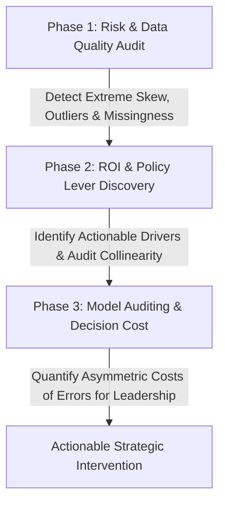
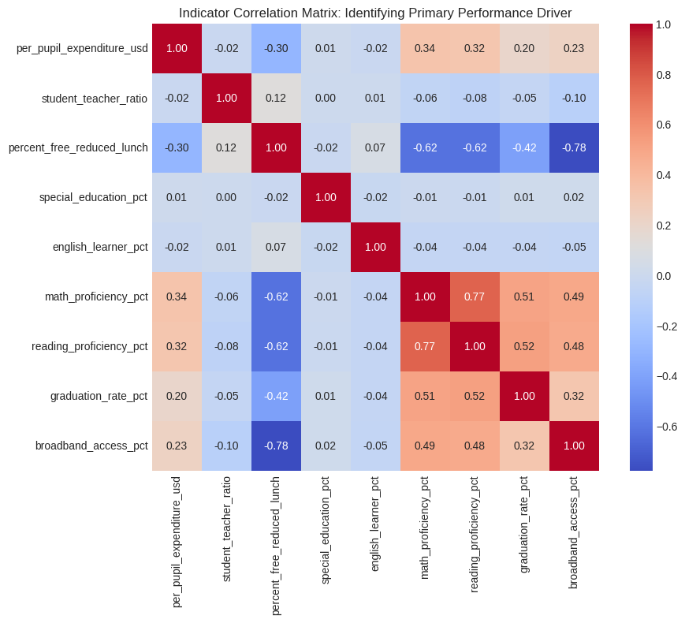
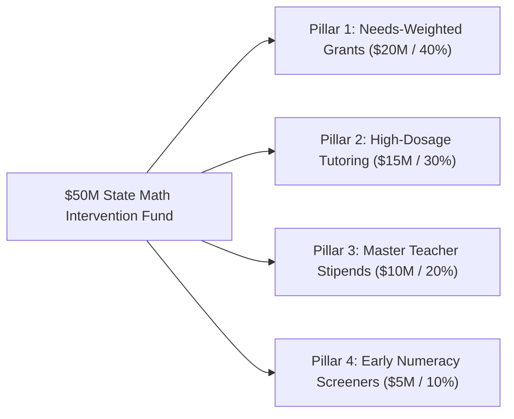

# 🎓 AltSchool Africa: Data Science Portfolio — Third Semester
### 🚀 Baraka 2026 Cohort | Machine Learning Workflows, Visual Diagnostics & Business Value

[](https://www.python.org/)
[](https://jupyter.org/)
[](https://pandas.pydata.org/)
[](https://scikit-learn.org/)
[](https://seaborn.pydata.org/)
[](https://altschoolafrica.com/)
[](https://github.com/iPablo26)

**Portfolio Author:** [Peter "Pablo" Okwukogu](https://github.com/iPablo26)  
**Program:** AltSchool Africa School of Data & Artificial Intelligence  
**Track:** Data Science (Semester 3: Machine Learning Specialization)

---

> [!IMPORTANT]
> ### ⚠️ Educational Use Disclaimer & Caveat
> The dataset utilized throughout this repository ([`us_education_system_dataset.csv`](us_education_system_dataset.csv)) is synthetically modeled and curated **strictly for educational, instructional, and statistical learning purposes**.
> 
> It is **NOT** an authentic reflection, official census data, or governmental report of the real-world United States Educational System, specific school districts, or actual operating institutions. All analyses, findings, and simulated policy recommendations serve purely to demonstrate data science, machine learning visualization, visual diagnostics, and business translation workflows.

---

## 📌 Executive Summary

Welcome to my central portfolio repository for the **Third Semester of the AltSchool Africa Data Science Program (Baraka 2026 Cohort)**. 

The focus of this semester is the complete **Machine Learning Lifecycle**: transitioning from descriptive statistics to predictive modeling, rigorous exploratory data analysis (EDA), diagnostic visualization, dimensionality reduction, feature selection, and translating complex machine learning outputs into high-stakes business and policy decisions.

A central philosophy developed in this portfolio is that **accuracy alone does not impress stakeholders**. A 95% accurate model is useless if decision-makers cannot understand, trust, or act on its predictions. Data visualization serves as the critical translation layer across every phase of the ML pipeline—from data quality auditing to feature engineering, error diagnostics, and capital allocation.

---

## 📂 Repository Structure

```text
Third-Semester-Baraka-2026---Data-Science/
├── .gitignore                                                                       # Clean Git ignore rules (OS, IDE, checkpoints)
├── 2D PCA Projection.png                                                            # Exported 2D PCA projection visual artifact
├── Business Lever Analysis - Title Staus.png                                        # Exported 4D Business Lever Bubble Plot (by Title I Status)
├── Business Lever Analysis.png                                                      # Exported 4D Business Lever Bubble Plot (by Governance Control)
├── Categories of ML Models.jpeg                                                     # Architectural taxonomy of Supervised vs. Unsupervised ML models
├── Confusion Matrix.png                                                             # Exported Random Forest Confusion Matrix heatmap
├── corr_matrix.png                                                                  # Exported 9-feature Correlation Matrix (Session 1: Attendance)
├── corr_matrix_features.png                                                         # Exported 9-feature Correlation Matrix (Session 2: Broadband & Drivers)
├── Evolution of ML.jpeg                                                             # Historical progression: Symbolic AI -> Statistical ML -> Python Ecosystem
├── Feature and Target.jpeg                                                          # Scikit-Learn tabular data representation: Features Matrix (X) & Target (y)
├── First Live Session Introduction to Visualization for ML.ipynb                    # Live Session 1 (Part 1): Univariate & Multivariate EDA
├── First Live Session Introduction to Visualization for ML - Continuation.ipynb       # Live Session 1 (Part 2): Correlation, Random Forest & PCA
├── README.md                                                                        # Comprehensive portfolio documentation
├── requirements.txt                                                                 # Reproducible Python dependencies
├── Resource Allocation.png                                                          # Exported Resource Allocation & Title I Audit visual artifact
├── Second Live Session - Business Value of Data Visualization for ML.ipynb          # Live Session 2 (Part 1): Phase 1 Resource Allocation & $50M Policy Audit
├── Second Live Session - Business Value of Data Visualization for ML Cont.ipynb     # Live Session 2 (Part 2): Business Levers & Collinearity Elimination
├── Third Session - Introduction to ML.ipynb                                         # Live Session 3: ML Evolution, Model Taxonomy, Estimator API & Preprocessing
├── us_education_system_data_dictionary.md                                           # 35-variable metadata schema & documentation
└── us_education_system_dataset.csv                                                  # Modeled dataset (5,000 records × 35 features)
```

---

## 🧭 Activities & Curriculum Tracker

| Session / Milestone | Module Focus | Core Deliverables / Artifacts | Status |
| :--- | :--- | :--- | :---: |
| **Live Session 01 (Part 1)** | **Introduction to Visualization for ML** | Univariate, Bivariate & Multivariate EDA on institutional data; skewness & interaction analysis ([`First Live Session Introduction to Visualization for ML.ipynb`](First%20Live%20Session%20Introduction%20to%20Visualization%20for%20ML.ipynb)) | ✅ Completed |
| **Live Session 01 (Part 2)** | **ML Visualization Continuation: Diagnostics & Dimensionality Reduction** | Correlation Matrix ([`corr_matrix.png`](./corr_matrix.png)), Random Forest Classifier ([`Confusion Matrix.png`](./Confusion%20Matrix.png)), & 2D PCA Embeddings ([`2D PCA Projection.png`](./2D%20PCA%20Projection.png)) ([`First Live Session Introduction to Visualization for ML - Continuation.ipynb`](First%20Live%20Session%20Introduction%20to%20Visualization%20for%20ML%20-%20Continuation.ipynb)) | ✅ Completed |
| **Live Session 02 (Part 1)** | **Business Value of Data Visualization for ML: Phase 1 Audit** | Advising State Dept of Ed on $50M Math Intervention; Spending Distribution Skew & Title I Boxplot Audit ([`Resource Allocation.png`](./Resource%20Allocation.png), [`Second Live Session - Business Value of Data Visualization for ML.ipynb`](Second%20Live%20Session%20-%20Business%20Value%20of%20Data%20Visualization%20for%20ML.ipynb)) | ✅ Completed |
| **Live Session 02 (Part 2)** | **Business Lever Discovery, Collinearity Audit & Policy Stratification** | 4D Business Lever Bubble Charts by Governance ([`Business Lever Analysis.png`](./Business%20Lever%20Analysis.png)) and Title I Tier ([`Business Lever Analysis - Title Staus.png`](./Business%20Lever%20Analysis%20-%20Title%20Staus.png)), & Primary Performance Driver Matrix ([`corr_matrix_features.png`](./corr_matrix_features.png)) ([`Second Live Session - Business Value of Data Visualization for ML Cont.ipynb`](Second%20Live%20Session%20-%20Business%20Value%20of%20Data%20Visualization%20for%20ML%20Cont.ipynb)) | ✅ Completed |
| **Live Session 03** | **Introduction to Machine Learning & The Scikit-Learn Estimator API** | Paradigm shift from Symbolic AI to ML ([`Evolution of ML.jpeg`](./Evolution%20of%20ML.jpeg)), ML Taxonomy ([`Categories of ML Models.jpeg`](./Categories%20of%20ML%20Models.jpeg)), $X$/$y$ Representation ([`Feature and Target.jpeg`](./Feature%20and%20Target.jpeg)), 5-Step Estimator API & Feature Processing ([`Third Session - Introduction to ML.ipynb`](Third%20Session%20-%20Introduction%20to%20ML.ipynb)) | ✅ Completed |
| **Module 03** *(Upcoming)* | **Supervised Learning: Regression** | Predictive modeling for continuous academic outcomes (`math_proficiency_pct`, `graduation_rate_pct`) | ⏳ Scheduled |
| **Module 04** *(Upcoming)* | **Supervised Learning: Classification** | Classification algorithms (Logistic Regression, Tree Ensembles, SVMs) for school risk tiers | ⏳ Scheduled |
| **Module 05** *(Upcoming)* | **Model Evaluation & Diagnostics** | ROC-AUC, Precision-Recall, Calibration Curves, Bias vs. Variance tradeoff & Cost Curves | ⏳ Scheduled |

---

## 🔬 Activity Spotlight: Live Session 03 — Introduction to Machine Learning & The Scikit-Learn Estimator API

*Notebook:* [`Third Session - Introduction to ML.ipynb`](Third%20Session%20-%20Introduction%20to%20ML.ipynb)  
*Visual Artifacts:* [`Evolution of ML.jpeg`](./Evolution%20of%20ML.jpeg) | [`Categories of ML Models.jpeg`](./Categories%20of%20ML%20Models.jpeg) | [`Feature and Target.jpeg`](./Feature%20and%20Target.jpeg)

### 1. Paradigm Shift: Traditional Software Engineering vs. Machine Learning
- **Traditional Programming (`Data + Handwritten Rules -> Output`):** Engineers explicitly code deterministic `IF/ELSE` rules. While effective for deterministic systems, hardcoded rules become brittle and fail to scale in complex real-world domains such as predicting student academic outcomes or detecting financial and identity fraud.
- **Machine Learning (`Data + Known Outputs -> Learned Rules`):** Algorithms ingest historical observations alongside known outcomes to automatically infer generalizable mathematical mappings and predictive patterns.


| Historical Era | Timeframe | Defining Characteristics & Tooling |
| :--- | :---: | :--- |
| **1. Early AI & Rules** | `1950s – 1980s` | Symbolic logic, expert systems, hardcoded `IF/ELSE` heuristics, fragile scaling on noisy real-world data. |
| **2. Statistical ML** | `1990s – 2000s` | Probabilistic models, statistical pattern detection, and data-driven function approximation. |
| **3. Python Ecosystem** | `2010s – Present` | Vectorized `NumPy` & `Pandas` arrays, unified `Scikit-Learn` Estimator API, and reproducible production ML pipelines. |

---

### 2. Machine Learning in the Data Science Workflow & Model Taxonomy
- **Data Science Intersection:** Sits at the confluence of **programming skills**, **mathematics & statistical rigor**, and **enterprise domain knowledge**.
- **Machine Learning as the Computational Engine:** Powers automated pattern discovery, structural grouping, and out-of-sample predictive inference across two primary learning paradigms:


1. **Supervised Learning (Models features $X$ to known labels $y$):**
   - **Classification (Discrete $y$):** Assigning observations into finite categories (e.g., classifying schools into *Below Median* vs. *Above Median* proficiency tiers).
   - **Regression (Continuous $y$):** Predicting continuous numerical quantities (e.g., forecasting exact `math_proficiency_pct` or `graduation_rate_pct`).
2. **Unsupervised Learning (Models features $X$ without labels $y$):**
   - **Clustering (Groupings):** Discovering natural institutional archetypes or peer school segments.
   - **Dimensionality Reduction:** Compressing high-dimensional feature spaces into orthogonal latent axes (e.g., `2D PCA` projection).

---

### 3. Scikit-Learn Data Representation & The 5-Step Estimator Workflow
To interface with Scikit-Learn's unified Estimator API, tabular institutional datasets are decomposed into two distinct mathematical structures:
- **Features Matrix ($X$):** A 2D matrix of shape `(n_samples, n_features)` containing the input predictors (e.g., `[Spending, Ratio, Lunch%]`).
- **Target Vector ($y$):** A 1D vector of length `(n_samples,)` containing the dependent outcome variable to be predicted (e.g., `[Proficiency]`).


#### 🔄 The 5-Step Scikit-Learn Estimator Workflow


---

### 4. Real-World Case Study: Education Performance Prediction Pipeline Setup
Applying this workflow to [`us_education_system_dataset.csv`](us_education_system_dataset.csv) (`5,000` institutions), the pipeline isolates high-signal predictors identified during our Phase 2 business lever audit and prepares them for Scikit-Learn transformers (`SimpleImputer` and `OneHotEncoder`):

| Pipeline Role | Variable Specification | Selected Columns | Preprocessing Strategy |
| :--- | :--- | :--- | :--- |
| **Numeric Predictors ($X_{\text{num}}$)** | `numeric_features` | `per_pupil_expenditure_usd`, `student_teacher_ratio`, `percent_free_reduced_lunch` | `SimpleImputer` (median/mean imputation) + scaling |
| **Categorical Predictors ($X_{\text{cat}}$)** | `categorical_features` | `title_i_status`, `control` | `OneHotEncoder` (orthogonal binary indicator expansion) |
| **Supervised Target ($y$)** | `target_col` | `math_proficiency_pct` | Target hygiene via `perf_data.dropna(subset=[target_col]).copy()` |

---

## 🔬 Activity Spotlight: Live Session 02 — Business Value of Data Visualization for ML

*Notebooks:*  
- **Part 1:** [`Second Live Session - Business Value of Data Visualization for ML.ipynb`](Second%20Live%20Session%20-%20Business%20Value%20of%20Data%20Visualization%20for%20ML.ipynb) *(Steps 1–2: Environment Setup & Resource Allocation Audit)*  
- **Part 2 (Continuation):** [`Second Live Session - Business Value of Data Visualization for ML Cont.ipynb`](Second%20Live%20Session%20-%20Business%20Value%20of%20Data%20Visualization%20for%20ML%20Cont.ipynb) *(Steps 3–4: Discovering Business Levers & Eliminating Redundant Features)*  
*Visual Artifacts:* [`Resource Allocation.png`](./Resource%20Allocation.png) | [`Business Lever Analysis.png`](./Business%20Lever%20Analysis.png) | [`Business Lever Analysis - Title Staus.png`](./Business%20Lever%20Analysis%20-%20Title%20Staus.png) | [`corr_matrix_features.png`](./corr_matrix_features.png)

### 1. The Core Problem: Why Business Leaders Don't Buy "Black Boxes"
- **Accuracy Alone is Not Enough:** Presenting a 95% model accuracy fails to convince executive stakeholders if they cannot understand *why* the model makes specific recommendations.
- **The Translation Layer:** Effective visualization bridges the gap between raw statistical algorithms and executive decision-making by making risk visible, highlighting actionable levers, and quantifying the cost of mistakes.

### 2. The 3-Phase Business-Valued ML Framework



1. **Phase 1: Risk & Data Quality Audit:** Detect corrupted, heavily skewed, or incomplete data before training models to avoid "garbage in, garbage out."
2. **Phase 2: ROI & Policy Lever Discovery:** Prevent leadership from investing capital into features that have near-zero impact on key performance targets.
3. **Phase 3: Model Auditing & Trust:** Frame model errors (False Positives vs. False Negatives) in tangible dollars, human cost, or policy consequences.

---

### 3. Phase 1 Audit: Advising the State Department of Education ($50M Intervention Fund)

**Executive Mandate:** As data science advisors to the State Department of Education, we were tasked with auditing institutional resources and student performance to guide the strategic deployment of a **$50 Million intervention fund** aimed at closing math proficiency gaps.


#### 📈 Deep Visual Audit & Intuitive Findings:

#### Plot 1: Financial Spending Distribution Across Institutions
- **The Typical School Baseline ($14,000 – $19,000):** The vast majority of institutions cluster tightly between $14,000 and $19,000 per pupil, peaking near $16,000–$17,000.
- **The High-Spending Right-Tail Skew ($30,000 – $50,000+):** The distribution exhibits a heavy positive skew. A small minority of wealthy or specialized institutions spend up to three times the typical baseline per student.
- **Executive Implication:** An unweighted, flat grant distribution would dilute capital by sending funds to institutions that already possess significant local funding bases, failing to elevate under-resourced schools above the necessary operational threshold.

#### Plot 2: Math Proficiency Rates by Title 1 Funding Tier
- **The 16-to-22 Percentage Point Deficit:**
  - **Title I Schoolwide (Deepest Poverty, 40%+ low income):** Median math proficiency is only **~51%** (middle 50% spanning 42% to 61%).
  - **Title I Targeted (Moderate Poverty):** Median math proficiency rises to **~59%**.
  - **Not Title I Eligible (Wealthier / Low Poverty):** Median math proficiency reaches **~67%** (IQR 58% to 77%).
  - **Not Applicable (Colleges / Private):** Median math proficiency tops at **~73%**.
- **The "Aid Paradox" Explained:** Title I funding provides supplementary federal dollars, yet these schools still significantly lag non-eligible schools. Title I status currently acts as a **marker of high systemic need** rather than an equalizer. Socioeconomic barriers (food insecurity, lack of broadband, teacher turnover) heavily compound learning challenges.
- **Positive Outliers ("Beat-the-Odds" Institutions):** Several Title I Schoolwide schools attain **80%+ math proficiency** (visible as upper whiskers and dots). These prove that socioeconomic disadvantage is not insurmountable and provide critical internal benchmarks for district-wide replication.

---

### 4. Phase 2 Audit: Business Lever Discovery, Collinearity & Multi-Dimensional Stratification

To prevent leadership from misallocating the $50M intervention fund into low-impact policy levers (such as blanket class-size reductions), Phase 2 evaluates 9 institutional, demographic, infrastructure, and outcome indicators to isolate the **Primary Performance Driver** and audit **feature collinearity**.

#### Step 4A: Indicator Correlation Matrix — Identifying Primary Performance Driver & Collinear Features



##### 🚨 Highlighting Collinear Features (Multicollinearity Diagnostic)

| Rank | Collinear Feature Pair | Pearson $r$ | Shared Variance ($R^2$) | Collinearity Severity | Structural & ML Modeling Implication |
| :---: | :--- | :---: | :---: | :---: | :--- |
| **1** | `percent_free_reduced_lunch` ↔ `broadband_access_pct` | **`-0.78`** | **60.8%** | 🔴 **Severe (Negative)** | **The "Socio-Digital Divide":** Over 60% of variance in student broadband access is explained by school poverty concentration. Including both in unregularized linear/logistic regressions inflates Variance Inflation Factors ($VIF \approx 2.55$) and destabilizes individual beta weights. |
| **2** | `math_proficiency_pct` ↔ `reading_proficiency_pct` | **`+0.77`** | **59.3%** | 🔴 **Severe (Positive)** | **Redundant Academic Targets:** Math and reading proficiency reflect a shared latent "general academic achievement" factor. When predicting `graduation_rate_pct`, include only one or combine them into a composite academic index. |
| **3** | `percent_free_reduced_lunch` ↔ `math_proficiency_pct` | **`-0.62`** | **38.4%** | 🟠 **High (Negative)** | **Primary Performance Driver:** Student economic need is the single strongest predictor of math performance decline across the entire dataset. |
| **4** | `percent_free_reduced_lunch` ↔ `reading_proficiency_pct` | **`-0.62`** | **38.4%** | 🟠 **High (Negative)** | **Primary Performance Driver:** Identical inverse impact on literacy as on numeracy (`r = -0.62`). |
| **5** | `reading_proficiency_pct` ↔ `graduation_rate_pct` | **`+0.52`** | **27.0%** | 🟡 **Moderate-High** | Literacy proficiency directly drives on-time high school completion. |
| **6** | `math_proficiency_pct` ↔ `graduation_rate_pct` | **`+0.51`** | **26.0%** | 🟡 **Moderate-High** | Numeracy proficiency co-drives graduation rates alongside reading. |
| **7** | `broadband_access_pct` ↔ `math_proficiency_pct` | **`+0.49`** | **24.0%** | 🟡 **Moderate (Confounded)** | Digital connectivity supports math learning, but its linear effect is heavily confounded by its `-0.78` collinearity with `percent_free_reduced_lunch`. |
| **8** | `broadband_access_pct` ↔ `reading_proficiency_pct` | **`+0.48`** | **23.0%** | 🟡 **Moderate (Confounded)** | Mirrors the math-broadband relationship (`+0.48`), acting as a co-proxy for household affluence. |

##### 🔍 Feature-by-Feature Relationship Breakdown (All 9 Indicators)
1. **`percent_free_reduced_lunch` (Dominant Negative Hub):** Strongly suppresses `broadband_access_pct` (`-0.78`), `math_proficiency_pct` (`-0.62`), `reading_proficiency_pct` (`-0.62`), and `graduation_rate_pct` (`-0.42`), while exhibiting a moderate negative link with `per_pupil_expenditure_usd` (`-0.30` — exposing regressive property-tax funding disparities).
2. **`broadband_access_pct` (Digital Infrastructure Proxy):** Positively associated with Math (`+0.49`), Reading (`+0.48`), Graduation Rate (`+0.32`), and Per-Pupil Expenditure (`+0.23`), but strongly inverse to Economic Need (`-0.78`).
3. **`per_pupil_expenditure_usd` (Financial Resource Lever):** Positively drives Math (`+0.34`), Reading (`+0.32`), Broadband (`+0.23`), and Graduation (`+0.20`), while remaining independent of `student_teacher_ratio` (`-0.02`), `special_education_pct` (`+0.01`), and `english_learner_pct` (`-0.02`).
4. **`math_proficiency_pct` & `reading_proficiency_pct` (Core Academic Outcomes):** Tightly coupled (`+0.77`) and identically impacted by poverty (`-0.62`), expenditure (`+0.34` / `+0.32`), and broadband (`+0.49` / `+0.48`).
5. **`graduation_rate_pct` (Downstream Culmination Outcome):** Driven by Reading (`+0.52`) and Math (`+0.51`) proficiency and depressed by student poverty (`-0.42`).
6. **`student_teacher_ratio` (Low-ROI Staffing Ratio — `|r| ≤ 0.12`):** Exhibits **near-zero linear correlation** with Math (`-0.06`), Reading (`-0.08`), and Graduation (`-0.05`). **Business Value Insight:** Prevents leadership from wasting millions on across-the-board class-size reductions that do not move proficiency without pedagogical intervention.
7. **`special_education_pct` & `english_learner_pct` (Orthogonal Demographic Features — `|r| ≤ 0.07`):** Statistically independent of every financial, socioeconomic, and academic outcome variable in the matrix (`r` between `-0.05` and `+0.07`).

---

#### Step 4B: Multivariate Business Lever Analysis — Stratified by Governance Control (`control`)


**4D Visual Encoding:**  
- **X-Axis:** `Economic Need (% Free/Reduced Lunch Students)` (`0%` to `100%`)  
- **Y-Axis:** `Math Proficiency Rate (%)` (`12%` to `96%`)  
- **Color (`hue`):** Institutional Governance (`Public`, `Private Religious`, `Private For-Profit`, `Public Charter`, `Private Non-Profit`)  
- **Bubble Size (`size`):** `per_pupil_expenditure_usd` (`$8,000` to `$48,000+`)

**Key Analytical & Policy Insights:**
- **Governance Alone Does Not Immunize Against Poverty:** As `percent_free_reduced_lunch` rises from `0%` to `98%`, math proficiency slopes downward at virtually the same rate across `Public` (blue), `Public Charter` (red), and `Private For-Profit` (green) institutions. Converting a high-poverty public school into a charter school without addressing economic and instructional needs does not automatically lift math scores.
- **Socioeconomic Sorting Across Sectors:** `Private Non-Profit` (purple) and `Private Religious` (orange) institutions are heavily concentrated in the affluent upper-left quadrant (`0%–25%` FRPL, `65%–96%` Math Proficiency) and frequently display larger expenditure bubbles (`$24,000–$48,000`), whereas `Public` and `Public Charter` schools serve the overwhelming majority of high-need communities (`50%–98%` FRPL).

---

#### Step 4C: Multivariate Business Lever Analysis — Stratified by Federal Title I Status (`title_i_status`)


**Key Analytical & Policy Insights:**
- **Visualizing the Statutory Policy Cliffs Along the X-Axis:**
  1. **`0%–25%` Economic Need Band:** Populated almost exclusively by `Not Applicable` (orange — private/higher-ed) at the `0%` vertical boundary and `Not Title I Eligible` (green) schools across `5%–25%` FRPL, achieving `55%–96%` math proficiency.
  2. **`20%–40%` Economic Need Transition Zone:** Dominated by `Title I Targeted` (red) institutions, where math proficiency steps down into a `35%–85%` band.
  3. **`≥ 40%` Economic Need Statutory Threshold (`40%–98%` FRPL):** Marking the federal 40% threshold where schools qualify for **`Title I Schoolwide`** (blue) designation. This cohort forms the entire lower-right tail of the distribution, with math proficiency falling as low as `12%–45%` when economic need exceeds `75%`.
- **The Capital Cushioning Effect ("Beat-the-Odds" Schools):** Within the blue `Title I Schoolwide` cloud (`40%–85%` FRPL), institutions with **larger bubble sizes (`per_pupil_expenditure_usd` ≥ `$24,000–$48,000`)** consistently cluster along the **upper boundary of their poverty tier (`60%–85%` math proficiency)**. This visually validates our core policy thesis: while poverty is the primary negative driver, **high-intensity, needs-weighted per-pupil investment combined with targeted instructional support enables high-poverty schools to beat the odds.**

---

### 5. Strategic Blueprint: Allocating the $50 Million Intervention Fund

Based on the combined Phase 1 and Phase 2 empirical evidence, the advisory blueprint allocates the $50M fund across four high-ROI pillars while explicitly rejecting low-leverage across-the-board staffing ratio reductions:



1. **Needs-Weighted School Grants & Socio-Digital Infrastructure ($20M / 40%):**  
   Targeted exclusively to `Title I Schoolwide` schools (`≥ 40%` FRPL) to close baseline per-pupil expenditure gaps and bundle home broadband/LTE hotspots (`r = -0.78` poverty-broadband collinearity) with adaptive math software.
2. **High-Dosage Math Tutoring ($15M / 30%):**  
   In-school, small-group tutoring (1:3 ratio) embedded during the school day—proven to deliver 2x to 3x standard academic year learning gains, unlike blanket `student_teacher_ratio` reductions (`r = -0.06`).
3. **Master Teacher Retention Stipends ($10M / 20%):**  
   Financial retention bonuses and mentorship load reductions to keep high-performing math educators in high-poverty `Title I Schoolwide` and `Title I Targeted` classrooms.
4. **Foundational Numeracy & Dual-Literacy Screening ($5M / 10%):**  
   Diagnostic screening tools deployed in elementary feeder schools to intercept both numeracy and reading comprehension deficits (`r = +0.77` math-reading coupling) before students reach middle-school algebra.

---

## 🔬 Activity Spotlight: Live Session 01 — Visualization Across the ML Lifecycle

### Part 1: Exploratory Data Analysis (Univariate & Multivariate Interactions)
*Notebook:* [`First Live Session Introduction to Visualization for ML.ipynb`](First%20Live%20Session%20Introduction%20to%20Visualization%20for%20ML.ipynb)

1. **Univariate Distribution & Skewness Analysis:**
   - **Per-Pupil Expenditure (`per_pupil_expenditure_usd`):** Right-skewed distribution (Mean: ~$17,113, Median: ~$16,830, IQR: $14,471–$19,228), with high-end outliers reaching $40,000–$50,000/pupil.
   - **Math Proficiency Stratification:** Boxplots across funding tiers highlighted foundational academic disparities linked to student socioeconomic status.
2. **Bivariate & Multivariate Interaction Modeling:**
   - Mapped `percent_free_reduced_lunch` (X-axis) against `math_proficiency_pct` (Y-axis), encoding governance `control` (Public, Charter, Private) as color and `per_pupil_expenditure_usd` as bubble size.
   - Confirmed a consistent inverse relationship between student poverty and math proficiency across all institutional governance types.

---

### Part 2: Feature Selection, Classification Diagnostics & Dimensionality Reduction
*Notebook:* [`First Live Session Introduction to Visualization for ML - Continuation.ipynb`](First%20Live%20Session%20Introduction%20to%20Visualization%20for%20ML%20-%20Continuation.ipynb)

#### 1. Correlation Matrix of Educational & Socioeconomic Indicators


**Key Analytical Findings & ML Workflow Implications:**
- **Academic Outcomes Move Together (Multicollinearity Alert):**  
  `math_proficiency_pct` and `reading_proficiency_pct` exhibit a strong positive relationship (`r = +0.77`), and both correlate with `graduation_rate_pct` (`+0.51` and `+0.52`). Including both in linear models risks multicollinearity.
- **Socioeconomic Hardship is the Dominant Underlying Driver (`percent_free_reduced_lunch`):**  
  Strongest negative correlation with Math and Reading proficiency (`r = -0.62`) and Graduation Rate (`r = -0.42`), alongside a positive link with `chronic_absenteeism_pct` (`r = +0.37`).
- **Attendance & Funding Levers:**  
  `chronic_absenteeism_pct` directly reduces proficiency (`-0.45`) and graduation (`-0.30`). `per_pupil_expenditure_usd` shows moderate positive correlation with Math (`+0.34`) and Reading (`+0.32`).
- **Non-Linear / Independent Demographic Features (`r ≈ 0.00`):**  
  `student_teacher_ratio` (`-0.08` to `+0.12`), `special_education_pct` (`-0.02` to `+0.01`), and `english_learner_pct` (`-0.04` to `+0.07`) show near-zero linear correlation with school-wide test scores—confirming that lower performance is not driven by Special Education or English Learner enrollment.

---

#### 2. Model Diagnostic: Random Forest Confusion Matrix Heatmap
To evaluate how well institutional and socioeconomic indicators predict academic standing, a **Random Forest Classifier** (`n_estimators=100`, 70/30 train-test split on `5,000` records = `1,500` test schools) was trained to classify schools into **Below Median (`0`)** vs. **Above Median (`1`)** Math Proficiency (`math_proficiency_pct`).


| Quadrant | True Label | Predicted Label | Count | Diagnostic Meaning |
| :--- | :--- | :--- | :---: | :--- |
| **Top-Left** *(True Negative)* | Below Median | Below Median | **595** | Correctly identified struggling/below-median schools (**81.4% Recall** for Below Median). |
| **Bottom-Right** *(True Positive)* | Above Median | Above Median | **590** | Correctly identified high-performing/above-median schools (**76.7% Recall** for Above Median). |
| **Top-Right** *(False Positive)* | Below Median | Above Median | **136** | *Over-Optimistic Error:* Struggling schools misclassified as Above Median (risk of missing needed intervention). |
| **Bottom-Left** *(False Negative)* | Above Median | Below Median | **179** | *Conservative False Alarm:* Above-median schools flagged as Below Median (safer error in resource allocation). |

**Key Diagnostic Insights:**
- **79.0% Overall Test Accuracy (`1,185 / 1,500` correct):** Strong out-of-sample predictive accuracy across a balanced test set (`731` actual Below Median vs. `769` actual Above Median).
- **Favorable Error Asymmetry for Policy Intervention:** The model makes fewer high-risk misses (`136` struggling schools overlooked) than conservative false alarms (`179` borderline schools flagged for support).

---

#### 3. Dimensionality Reduction: 2D PCA Projection
Using `StandardScaler` and **Principal Component Analysis (`PCA(n_components=2)`)**, the 8 standardized predictor variables were projected onto a 2D plane to inspect class separability and latent structure.


**Key Analytical Findings & Workflow Implications:**
- **44.7% Total Variance Captured in 2D (`31.9%` on PC1 + `12.8%` on PC2):** Nearly half of multidimensional variance is preserved in two orthogonal axes.
- **PC1 (`31.9% Variance`) Represents the Socioeconomic & Academic Readiness Axis:** Class separation occurs almost entirely from left to right along PC1: **Low Tier (`0`, green)** schools cluster on the left (`PC1 < 0`), while **High Tier (`1`, orange)** schools cluster on the right (`PC1 > 0`).
- **PC2 (`12.8% Variance`) Captures Non-Performance Structural Variation:** Both green and orange clouds span the exact same vertical range (`-4` to `+3.5`), capturing staffing ratios and demographic composition independent of performance tier.
- **Visualizing the Confusion Matrix Overlap (The "Fuzzy Middle"):** The continuous central overlap zone (`-1.5 ≤ PC1 ≤ +1.5`) visually explains why the Random Forest model incurred `315` misclassifications on borderline institutions near the 50th percentile cutoff.

---

## 📊 Dataset & Schema Overview

The primary dataset modeled in this repository encapsulates **5,000 educational institutions** across all 50 US states and Washington D.C., encompassing **35 analytical dimensions**.

| Category | Representative Variables | Analytical Significance |
| :--- | :--- | :--- |
| **Institutional Context** | `institution_id`, `state_code`, `nces_locale`, `level`, `control`, `title_i_status` | Geographic distribution, school grade tier, governance |
| **Resources & Staffing** | `total_enrollment`, `number_of_teachers`, `student_teacher_ratio`, `per_pupil_expenditure_usd` | Capacity, teacher density, institutional funding intensity |
| **Socioeconomic & Demographics** | `percent_free_reduced_lunch`, `racial_*_pct`, `special_education_pct`, `english_learner_pct` | Student body composition, language assistance, SES index |
| **Financial Allocations** | `federal_funding_pct`, `state_funding_pct`, `local_funding_pct` | Fiscal mechanics (local property taxes vs. state/federal aid) |
| **Academic Outcomes** | `math_proficiency_pct`, `reading_proficiency_pct`, `graduation_rate_pct`, `avg_sat_score`, `avg_act_score` | Core target variables for predictive and diagnostic ML modeling |

> 📖 *For complete field descriptions, allowable ranges, and data types, refer to the full [Data Dictionary Documentation](us_education_system_data_dictionary.md).*

---

## 🛠️ Tech Stack & Environment

- **Core Language:** Python 3.10+
- **Environment:** Jupyter Notebook / Google Colab / VS Code
- **Data Manipulation:** `pandas`, `numpy`, `scipy`
- **Machine Learning & Dimensionality Reduction:** `scikit-learn` (`RandomForestClassifier`, `PCA`, `StandardScaler`, `OneHotEncoder`, `SimpleImputer`, `confusion_matrix`)
- **Statistical Visualization:** `matplotlib`, `seaborn`
- **Version Control:** Git & GitHub

---

## 🚀 Getting Started Locally

### 1. Clone the Repository
```bash
git clone https://github.com/iPablo26/Third-Semester-Baraka-2026---Data-Science.git
cd Third-Semester-Baraka-2026---Data-Science
```

### 2. Set Up a Virtual Environment
```bash
# macOS / Linux
python3 -m venv .venv
source .venv/bin/activate

# Windows
python -m venv .venv
.venv\Scripts\activate
```

### 3. Install Dependencies
```bash
pip install --upgrade pip
pip install -r requirements.txt
```

### 4. Launch Jupyter Notebook
```bash
jupyter notebook
```

Open any of the interactive notebooks to explore the workflows:
- [`First Live Session Introduction to Visualization for ML.ipynb`](First%20Live%20Session%20Introduction%20to%20Visualization%20for%20ML.ipynb) — *Live Session 1 (Part 1): Univariate, Bivariate & Multivariate EDA*
- [`First Live Session Introduction to Visualization for ML - Continuation.ipynb`](First%20Live%20Session%20Introduction%20to%20Visualization%20for%20ML%20-%20Continuation.ipynb) — *Live Session 1 (Part 2): Correlation Matrices, Random Forest Diagnostics & 2D PCA Projections*
- [`Second Live Session - Business Value of Data Visualization for ML.ipynb`](Second%20Live%20Session%20-%20Business%20Value%20of%20Data%20Visualization%20for%20ML.ipynb) — *Live Session 2 (Part 1): Business-Valued ML Framework, Financial Audit & $50M Policy Intervention*
- [`Second Live Session - Business Value of Data Visualization for ML Cont.ipynb`](Second%20Live%20Session%20-%20Business%20Value%20of%20Data%20Visualization%20for%20ML%20Cont.ipynb) — *Live Session 2 (Part 2): Business Lever Discovery (4D Scatterplots) & Eliminating Redundant Features (Collinearity Matrix)*
- [`Third Session - Introduction to ML.ipynb`](Third%20Session%20-%20Introduction%20to%20ML.ipynb) — *Live Session 3: Evolution of ML, Model Taxonomy, 5-Step Scikit-Learn Estimator API & Feature Processing*

---

## 👤 Author & Connect

**Peter "Pablo" Okwukogu**  
- GitHub: [@iPablo26](https://github.com/iPablo26)  
- Focus: Data Science, Machine Learning, Cloud Architecture & AI Engineering  
- Cohort: AltSchool Africa Data Science — Baraka 2026  

---

## 📄 License & Attribution

This project is licensed under the MIT License — see the repository for details. Created as part of the AltSchool Africa 2026 learning curriculum.
